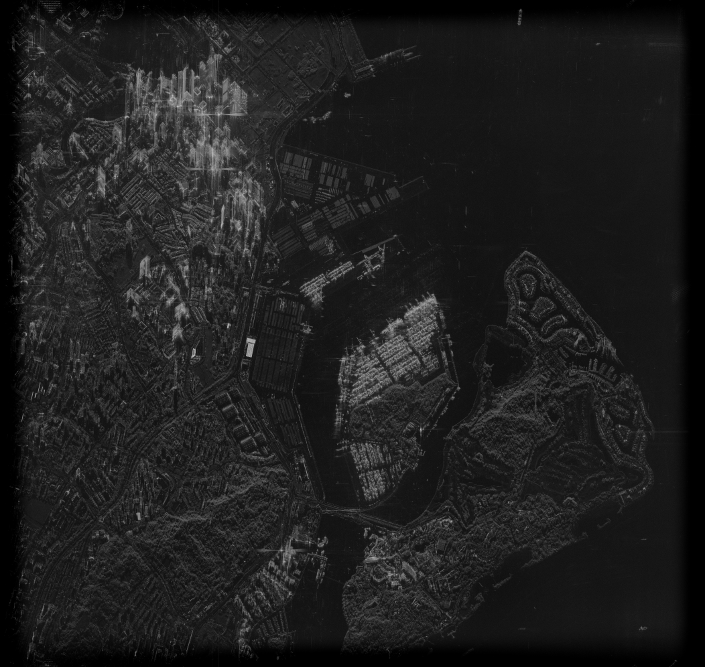

# nitv-cpp

Read a NITF file, write a PNG of its image data.

Inspired by [nitf-viz](https://github.com/holmesv3/nitf-viz) but I don't know Rust that well.

For now its just an image viewer but maybe this can be branched out further (better image viewer? maybe throw in a processor here? something cool?)

Building via the script `build.sh` is the easiest way to install. Its very naive but this is small so it won't matter that much.

You can run it like `nitv some_sicd.nitf --output . --size 1024`

Loosely the flow is:

1. parse the NITF headers

2. decide what kind of picture this is

3. memory-map each image segment's pixel data

4. address it as one logical image

5. resample to the requested output size

6. write a PNG

Current quality is terrible but this is it:

Other smaller one:
1[should load](sample-pngs/2025-UMBRA_SICD.png)

## Not supported

Compression of any kind, block masks (`IC` = `NM`/`M*`), pixel sizes other
than 1 byte for MONO / 3 for RGB / 8 for SICD, `IMODE` other than `P` for RGB,
blocked SICD (`IMODE=B`), images split along columns rather than rows, and
SICD stored as `AMP8I_PHS8I`.
